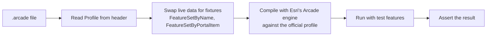

# Arcade Shelter Operations

[](https://github.com/MoPhD26/arcade-shelter-operations/actions/workflows/ci.yml)


Fifteen ArcGIS Arcade expressions that run an emergency shelter network across the whole ArcGIS system: the map, the popups, the Field Maps form, the geodatabase, and the operations dashboard.

**Every expression is tested automatically.** The test suite runs each one through Esri's own Arcade engine (from the ArcGIS Maps SDK for JavaScript) on every push, against the same profile the expression uses in ArcGIS. Most Arcade lives inside web maps where nobody can review or test it. This repository treats Arcade as code.

## The scenario

During a flood, a county opens shelters and needs to know, at all times, which ones have beds, which are filling up, and which records cannot be trusted. Field staff update occupancy from their phones, and an operations center watches a dashboard. The same shelter standard has to hold in every one of those places.

This repository is the companion to [arcpy-incident-response-toolkit](https://github.com/MoPhD26/arcpy-incident-response-toolkit), which checks the same shelter standard in batch with Python. Here, the standard is enforced live, at the point of collection and in the database.

## What is in it

| Where it runs | Expression | What it does |
|---|---|---|
| **Map style** | [Shelter status category](expressions/visualization/shelter_status_category.arcade) | Available, Filling, At capacity, Closed, or Check data for bad records |
| **Labels** | [Shelter label](expressions/labeling/shelter_label.arcade) | Name and open beds on two lines, with correct singular and plural |
| **Popups** | [Shelter summary](expressions/popups/shelter_summary.arcade) | Rich text element with color coded occupancy |
| | [Capacity chart](expressions/popups/capacity_chart.arcade) | Pie chart of occupied and open beds, built in Arcade |
| | [Nearby incidents](expressions/popups/nearby_incidents.arcade) | Incidents within 2 km of the shelter, grouped by type, using a geodetic buffer |
| **Field Maps forms** | [Percent full](expressions/forms/percent_full.arcade) | Calculated field, null instead of wrong when inputs are missing |
| | [Closure reason visibility](expressions/forms/closure_reason_visible.arcade) | Shows the closure reason question only for closed shelters |
| | [Inspection due](expressions/forms/inspection_due.arcade) | Never inspected, Overdue, Due in N days, or Current |
| **Field calculation** | [Normalize status](expressions/field-calculation/normalize_status.arcade) | Fixes case and spacing, never guesses unknown values |
| **Attribute rules** | [Occupancy within capacity](expressions/attribute-rules/constraint_occupancy_within_capacity.arcade) | Constraint rule. Blocks impossible numbers from any app |
| | [Occupancy timestamp](expressions/attribute-rules/calc_occupancy_timestamp.arcade) | Calculation rule. Stamps the time only when occupancy actually changes |
| | [Evacuation zone](expressions/attribute-rules/calc_evacuation_zone.arcade) | Calculation rule. Spatial lookup of the zone each shelter sits in |
| | [Full status check](expressions/attribute-rules/validation_full_status.arcade) | Validation rule. Flags shelters marked Full that are not |
| **Dashboards** | [County summary](expressions/dashboards/county_summary_data_expression.arcade) | Data expression. GroupBy to one row per county, excluding closed shelters |
| | [Beds in use indicator](expressions/dashboards/beds_indicator_formatting.arcade) | Advanced formatting with threshold colors and a safe no value state |

Full details for each one are in the [expression catalog](docs/CATALOG.md), which is generated from the expression headers.

## How the testing works



* **Real engine, real profiles.** Expressions run through `createArcadeExecutor` from `@arcgis/core`, Esri's JavaScript SDK. Map, popup, form, and field calculation expressions compile against Esri's built in profile definitions, so an expression that uses a variable its profile does not provide fails the build. Attribute rule and Dashboard profiles are declared from the Esri documentation.
* **Data sources become fixtures.** Calls to `FeatureSetByName` and `FeatureSetByPortalItem` are swapped for small in memory FeatureSets, so popups, attribute rules, and data expressions that query other layers are tested without a portal.
* **Consistency tests.** The same occupancy thresholds appear in the map style, the popup, and the dashboard indicator. A test checks all three agree at eight occupancy levels, so changing one without the others fails the build.
* **Documentation is enforced.** Every expression must have a header with its profile, where it is used, and what it returns. The catalog is rebuilt from those headers and CI fails if it is out of date.

Two small shims let the browser SDK run in Node: one serves the geometry engine's WebAssembly file from disk, and one gives the SDK's in thread worker an event dispatcher. See [test/support/node-env.mjs](test/support/node-env.mjs).

## Run the tests

You need Node.js 20 or later.

```bash
npm install
npm test
```

```
✔ status category follows occupancy thresholds
✔ nearby incidents counts only those within 2 km, grouped by category
✔ constraint blocks impossible numbers with a clear message
✔ county summary excludes closed shelters and computes percent full
✔ style, popup, and dashboard agree at 90% occupancy
...
ℹ tests 52
ℹ pass 52
```

## Use the expressions in ArcGIS

The expressions expect a shelter layer with these fields: `NAME`, `STATUS`, `SHELTER_TYPE`, `COUNTY`, `CAPACITY`, `OCCUPANCY`, `PCT_FULL`, `LAST_INSPECTED`, `OCC_UPDATED`, `CLOSURE_REASON`, `ZONE_ID`.

| Expression type | Where to paste it |
|---|---|
| Style and labels | Map Viewer, layer Styles or Labels, then Use expression. In ArcGIS Pro, the symbology or label class expression with the Arcade language |
| Popups | Map Viewer, Configure pop-ups, Add content, Arcade |
| Forms | Map Viewer, Forms, select the field, then Calculated expression or Visibility |
| Field calculation | ArcGIS Pro Calculate Field with the Arcade expression type, or Map Viewer, Data, Calculate |
| Attribute rules | ArcGIS Pro, Data Design, Attribute Rules. Requires a file or enterprise geodatabase |
| Dashboards | Data expression: replace `REPLACE_WITH_SHELTERS_ITEM_ID` with your layer's item ID. Advanced formatting: an indicator using Sum of CAPACITY and Sum of OCCUPANCY |

## Repository layout

```
arcade-shelter-operations/
├── expressions/              # The Arcade, one folder per ArcGIS profile
├── test/
│   ├── support/arcade.mjs    # Harness: profiles, data injection, execution
│   ├── support/node-env.mjs  # Shims so the SDK runs in Node
│   ├── fixtures/data.mjs     # Synthetic incidents, zones, and shelters
│   └── *.test.mjs            # 52 tests
├── scripts/build-catalog.mjs # Builds docs/CATALOG.md from expression headers
├── docs/CATALOG.md
└── .github/workflows/ci.yml  # Catalog check and tests on every push
```

## About

Built by **Mogahid Hussein, Ph.D., GISP**, a former Esri Senior Instructor and Course Advocate for ArcGIS Arcade, who taught Arcade, Python, and ArcGIS Pro to more than 1,000 professionals.

All data is synthetic. No proprietary course materials or datasets are included.

## License

MIT
